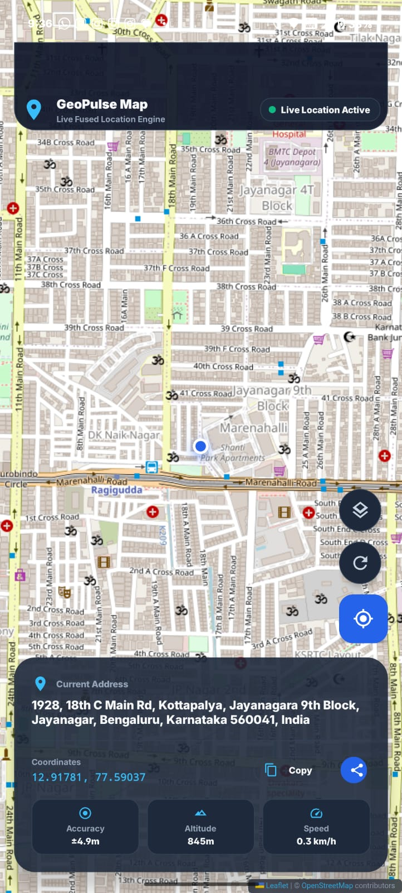

# 📍 GeoPulse Map — Live Location & Map App


-success.svg)


**GeoPulse Map** is a premium, modern Android application that retrieves the device's exact geographical location using Google Play Services **Fused Location Provider** and displays it on an interactive embedded **WebView Map** with live telemetry, geocoded address lookup, and sleek Material 3 UI controls.

---

## 📱 Application Preview

<div align="center">
  
</div>

---

## ✨ Key Features

- **🚀 Fused Location Engine**: Continuously streams high-accuracy GPS coordinates (`Priority.PRIORITY_HIGH_ACCURACY`).
- **🗺️ Keyless Embedded Map**: Interactive HTML5 map powered by Leaflet.js inside `WebView`. **Requires ZERO API Keys or billing setup**.
- **🎨 Multi-Theme Map Layers**: Smoothly cycle between **Standard (OpenStreetMap)**, **Dark Mode (CartoDB)**, and **Satellite Imagery (Esri)**.
- **📍 Real-Time Pulse Marker**: Animated pin with an expanding accuracy pulse ring showing your precise location.
- **🏡 Automated Geocoding**: Asynchronously converts Lat/Lng into full human-readable street addresses using Android's `Geocoder`.
- **📊 Live Telemetry Dashboard**:
  - **Accuracy** ($\pm \text{meters}$)
  - **Altitude** ($\text{meters}$)
  - **Speed** ($\text{km/h}$)
  - **GPS Status** (Searching / Live Active / Offline)
- **⚡ Utility Actions**:
  - **Copy Coordinates**: One-tap copy `latitude, longitude` to clipboard.
  - **Share Location**: Generates a Google Maps link (`https://maps.google.com/?q=lat,lng`) to share via WhatsApp, Messages, or Email.
  - **Recenter Map**: Instantly pans and zooms back to your current position.
- **🛡️ Graceful Permission Handling**: Smooth runtime permission prompts and offline GPS rationale cards.

---

## 🛠️ Tech Stack & Dependencies

- **Language**: Kotlin
- **Architecture**: Single Activity / View-based Layout with Edge-to-Edge Insets
- **Location API**: Google Play Services `play-services-location:21.4.0`
- **Map Engine**: Leaflet.js + OpenStreetMap / CartoDB / Esri in WebView
- **UI Components**: Google Material 3 (`com.google.android.material:material:1.14.0`), ConstraintLayout
- **Asynchronous Logic**: Kotlin Coroutines (`Dispatchers.IO` / `lifecycleScope`)

---

## 📁 Project Structure

```
app/src/main/
├── assets/
│   └── map.html                  # Embedded Leaflet HTML5/JS map canvas
├── java/com/example/googlemap/
│   └── MainActivity.kt           # Core logic: FusedLocation, Geocoder, JS Bridge, UI
└── res/
    ├── layout/
    │   └── activity_main.xml     # Glassmorphic top header, WebView, FABs, Telemetry card
    ├── drawable/                 # Custom vector icons & glassmorphic backgrounds
    └── values/
        ├── colors.xml            # Premium slate/blue theme palette
        ├── strings.xml           # Localized strings
        └── themes.xml            # Material 3 dark theme
```

---

## 🔑 Why No API Key is Needed

Unlike standard native Google Maps SDKs that require a Google Cloud account, billing activation, and a restricted `GEO_API_KEY`:

1. **Leaflet & OpenStreetMap**: Map tile layers are requested directly from public tile servers without API key validation.
2. **Fused Location Provider**: Native Android system API built into Google Play Services — completely free.
3. **Android Geocoder**: On-device geocoding service provided by the OS.

---

## 🚀 Getting Started

### Prerequisites
- Android Studio Ladybug (2024.2+) or newer
- Android SDK 36
- Android device or emulator with Google Play Services (API 24+)

### Installation & Build

1. **Clone the Repository**:
   ```bash
   git clone https://github.com/your-username/googlemap.git
   cd googlemap
   ```

2. **Open in Android Studio**:
   - Select **File -> Open** and choose the `googlemap` root folder.
   - Let Gradle sync automatically.

3. **Build & Run**:
   - Connect an Android device or start an emulator.
   - Click **Run 'app'** or execute in terminal:
     ```bash
     ./gradlew assembleDebug
     ```

4. **Grant Permissions**:
   - Launch the app and grant **Location Access** when prompted.

---

## 📄 License

This project is open-source and available under the [MIT License](LICENSE).
